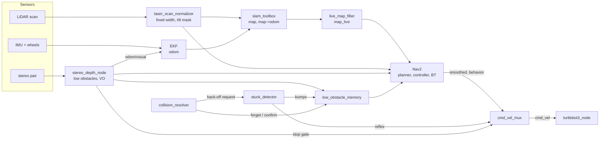

# TurtleBot3 fleet workspace (robot side)

This is the robot half of the fleet. Each Raspberry Pi runs bringup, SLAM Toolbox and Nav2 under its own namespace (`/blinky`, `/pinky`, `/inky`, `/clyde`) and talks to the central PC only through Zenoh over Tailscale. The central PC (`~/central-computer`) picks frontiers and sends `NavigateToPose` goals. Everything that keeps the robot safe and moving runs here, so a dropped link stops new goals but never drives the robot blind.

| Doc | What is in it |
| --- | --- |
| this README | running the robot, how the stack fits together, quick troubleshooting |
| [docs/navigation.md](docs/navigation.md) | every node in detail: sensor fusion, the Zenoh link, motion commands, recovery, stuck detection, low-obstacle memory, stereo, tilt gate, Nav2 troubleshooting |
| [docs/setup.md](docs/setup.md) | one-time Pi setup: Ubuntu, ROS 2 Humble, building this workspace, Wi-Fi, udev names, OpenCR firmware, LiDAR model |
| [docs/diagnostics.md](docs/diagnostics.md) | debug captures and analyzers |
| [docs/orca_hybrid_operator_runbook.md](docs/orca_hybrid_operator_runbook.md) | the ORCA experiment (off by default) |

## Quick start

Normally you do not log in to the robot at all. From the central PC:

```bash
cd ~/central-computer
./scripts/core/start_fleet.sh -i        # inky; letters b/p/i/c pick robots
```

That SSHes in and runs the three robot commands below, then starts the central stack. To run them by hand, use three SSH terminals on the robot:

```bash
# 1. bringup: base, LiDAR, IMU, EKF, URDF
ros2 launch turtlebot3_bringup robot.launch.py
# 2. SLAM + Nav2 + helpers (waits for odom TF, then starts Nav2; a short forward move seeds the map)
ros2 launch turtlebot3_navigation2 navigation2_slam.launch.py
# 3. Zenoh link to the central PC (its Tailscale name)
./scripts/comms/start_zenoh_robot.sh reverie
```

`~/.bashrc` sources `scripts/env/ros_robot_env.bash` (ROS, this overlay, Cyclone loopback config, the robot's domain) and sets `TURTLEBOT3_MODEL=burger`, `LDS_MODEL=LDS-02` ([setup](docs/setup.md)). Without the central PC, `navigation2_slam.launch.py fleet_mode:=false` adds a static `map -> <robot>/map` so RViz goals work on the bench.

After editing anything under `src/`, rebuild on the Pi: `./scripts/build/rebuild_common.sh`. The workspace uses `--symlink-install`, so Python scripts, launch files, parameters and behavior trees take effect on the next launch; C++ nodes (`cmd_vel_mux`, `tf_zenoh_relay`, `stereo_pair_throttle`) need the rebuild.

## Robot fleet reference

| Robot  | Tailscale (preferred) | Azure hotspot         | Robot ROS domain |
| ------ | --------------------- | --------------------- | ---------------- |
| Blinky | `blinky@blinky`       | `blinky@172.20.10.13` | 5  |
| Pinky  | `pinky@pinky`         | `pinky@172.20.10.14`  | 22 |
| Inky   | `inky@inky`           | `inky@172.20.10.15`   | 19 |
| Clyde  | `clyde@clyde`         | `clyde@172.20.10.16`  | 80 |

On boot the Pi tries **TAMU_WiFi** (WPA Enterprise, DHCP) first, then the **Azure** hotspot. Tailscale gives the same name on either network. Hardware: TurtleBot3 Burger, Raspberry Pi 4, Ubuntu Server 22.04, ROS 2 Humble. Inky also has a stereo camera pair and no ultrasonics (`config/sensors/inky.yaml`, `config/stereo/inky.yaml`).

The namespace is the hostname unless it is a stock name such as `ubuntu`; then it is the login user. Pass `robot_name:=<name>` to both launch files to override it.

## How the stack fits together



- **Maps.** `slam_toolbox` builds `/<robot>/map` from the normalized LiDAR scan. `live_map_filter` publishes `map_live`, the same map without obstacles the LiDAR now sees through (an opened door, a moved chair); Nav2's global costmap and the central PC use it.
- **Low obstacles** below the LiDAR plane (chair feet, boxes, cables) come from stereo and from bumps. The local costmap gets stereo marks at once; `low_obstacle_memory` keeps confirmed marks and bumps for 20 minutes in both costmaps, so a robot coming back to a room plans around what it found there.
- **Motion.** `cmd_vel_mux` is the only node that publishes `cmd_vel`. It takes the controller (through the velocity smoother), Nav2's spin/backup, and `stuck_detector`'s reflexes, in rising priority, and clamps Nav2's forward speed while a stop gate (stereo, ultrasonic) is closed. One driver at a time is what keeps the robot from shaking when two nodes disagree.
- **Recovery** runs in layers: the controller slows near obstacles; the behavior tree (`behavior_trees/navigate_to_pose_explore.xml`) clears stale costmap marks away from the robot and backs up, spins or waits; `collision_resolver` checks each "collision ahead" against the sensors; `stuck_detector` handles stalls, slips, tilts and standing too close to plan; the central explorer gives up on goals that keep failing. Details: [Recovery: who does what](docs/navigation.md#recovery-who-does-what).

| Where | What |
| --- | --- |
| `src/turtlebot3/turtlebot3_bringup/launch/robot.launch.py` | base, LiDAR, IMU, EKF, URDF/TF |
| `src/turtlebot3/turtlebot3_navigation2/launch/navigation2_slam.launch.py` | SLAM, Nav2 and every helper node; all launch arguments |
| `src/turtlebot3/turtlebot3_navigation2/launch/navigation_launch_multirobot.py` | the Nav2 servers (one process each, namespaced TF) |
| `src/turtlebot3/turtlebot3_navigation2/param/humble/burger.yaml` | Nav2 parameters; `mapper_params_online_async_fast.yaml` for SLAM |
| `src/turtlebot3/turtlebot3_navigation2/behavior_trees/navigate_to_pose_explore.xml` | the robot's behavior tree |
| `src/turtlebot3/turtlebot3_navigation2/scripts/` | helper nodes (`stuck_detector.py`, `collision_resolver.py`, `low_obstacle_memory.py`, stereo, ...) |
| `src/turtlebot3/turtlebot3_navigation2/src/` | C++ nodes: `cmd_vel_mux`, `tf_zenoh_relay`, `stereo_pair_throttle` |
| `scripts/comms/start_zenoh_robot.sh`, `config/zenoh/robot_client.json5.tmpl` | the Zenoh link and what crosses it |
| `config/sensors/<robot>.yaml`, `config/stereo/<robot>.yaml` | per-robot optional hardware and stereo calibration |

### Main launch arguments (`navigation2_slam.launch.py`)

| Argument | Default | |
| --- | --- | --- |
| `fleet_mode` | `true` | driven by the central PC; `false` for a bench test |
| `robot_name` / `namespace` | hostname or user | override the namespace |
| `use_custom_bt_recovery_tree` | `true` | `navigate_to_pose_explore.xml`; `false` for Nav2's stock tree |
| `enable_stuck_detector`, `enable_collision_resolver`, `low_obstacle_memory`, `live_map_filter` | `true` | turn a helper off |
| `nav2_enable_stereo_blob_layer`, `enable_stereo_cmd_vel_enforcer`, `stereo_visual_odometry` | `true` | stereo pieces (need a usable calibration) |
| `scan_costmap_max_hz` | `6.0` | costmap scan rate; `0` feeds costmaps the full-rate scan |
| `enable_startup_map_seeding` | `true` | the 3 s forward move that seeds the first map |

The rest (ultrasonic tuning, the optional retrace/lethal-watch/ORCA helpers) are described in the launch file and in [docs/navigation.md](docs/navigation.md).

## Troubleshooting

- **Robot shakes or stutters, especially backing up:** something other than `cmd_vel_mux` publishes `cmd_vel`. `ros2 topic info /<robot>/cmd_vel` should list exactly one publisher (plus `turtlebot3_node` subscribing); `ros2 topic echo /<robot>/cmd_vel_mux/active` shows which input is driving.
- **Robot stops in open space for a few seconds:** look for `stereo stop: forward blocked` in the log (a stereo obstacle in its path) or `collision ahead` from the controller; `collision_resolver` logs a verdict on each give-up. `Stereo cameras are out of alignment` means stereo is off until it is recalibrated (below).
- **Repeatedly drives into the same low object:** check `low_obstacle_memory` logs `remembered bump` and that `stereo_depth_node` reports status `ok`. A camera that dropped off USB (`no_images`, or `Failed opening device ... busy` at launch) leaves only bumps; reseat the cable and restart.
- **"Stereo cameras are out of alignment":** a camera moved, often after a battery swap. With the robot still and the stack running: `ros2 run turtlebot3_navigation2 stereo_refine_extrinsics.py --ros-args -r __ns:=/<robot>`. Full calibration order is in [docs/navigation.md](docs/navigation.md#troubleshooting-nav2--slam-on-robot).
- **"Control loop missed its desired rate":** the Pi is short on CPU (`top -o %CPU`). `stereo_depth_node` is the largest consumer.
- **Nav2 never starts after `wait_for_tf`:** `odom -> base_footprint` never appeared; check bringup runs in the same namespace and domain (`echo $ROS_DOMAIN_ID`, `ros2 topic echo /<robot>/odom --once`).

More in [docs/navigation.md](docs/navigation.md#troubleshooting-nav2--slam-on-robot). To measure a run (jitter, time standing still with a goal, recovery events): record a small bag and run `scripts/diagnostics/analyze_motion_bag.py` ([diagnostics](docs/diagnostics.md)).
